# KXBuild — iOS Development for VS Code

**English** · [简体中文](../zh/vscode.md)

Build, run and debug iOS apps on a real iPhone from VS Code — on Windows, Linux and macOS.
Press F5 and your app is built, signed, installed on the iPhone connected over USB, and stopped at your breakpoint.

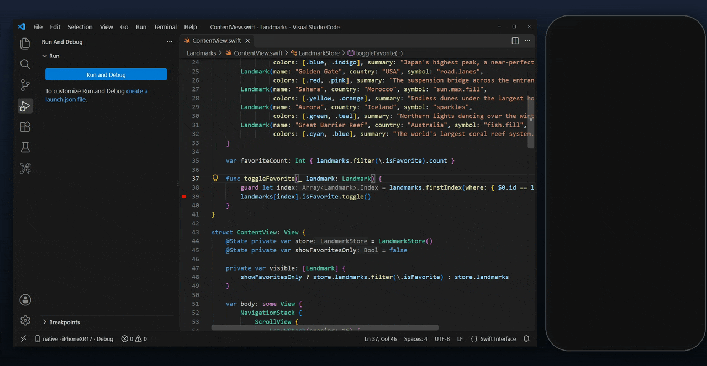

## Features

**Run and debug on a real iPhone.** F5 builds, signs and installs the app, then attaches the debugger. Set breakpoints in Swift and Objective-C, step through code, inspect variables (SwiftUI `@State` included) and use the Debug Console.

**Pick a device and a configuration.** The KXBuild view shows your license, the connected iPhone (USB or Wi-Fi), the Debug / Release configuration and the project's targets. Click a row to change it.

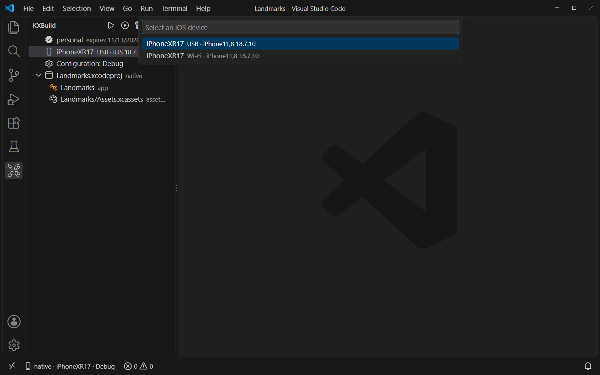

**Create a project in a few steps.** *KXBuild: New Project* offers SwiftUI, UIKit, Objective-C, React Native, Flutter, Expo and other templates, and opens the new project ready to run.

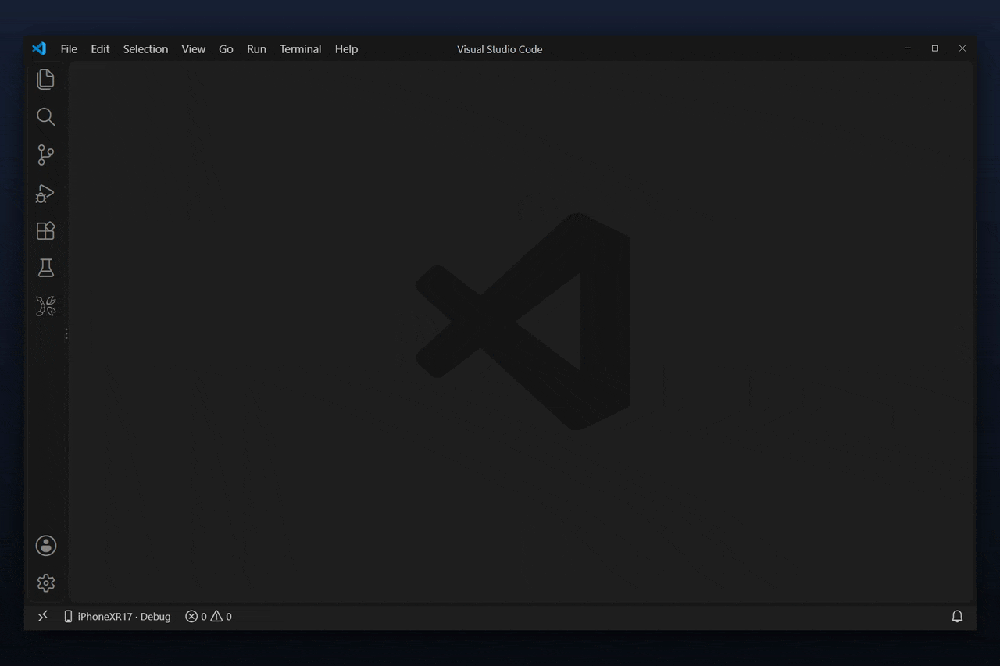

**Code completion before the first build.** Swift, Objective-C, C and C++ completion, go to definition and find references work as soon as the project opens.

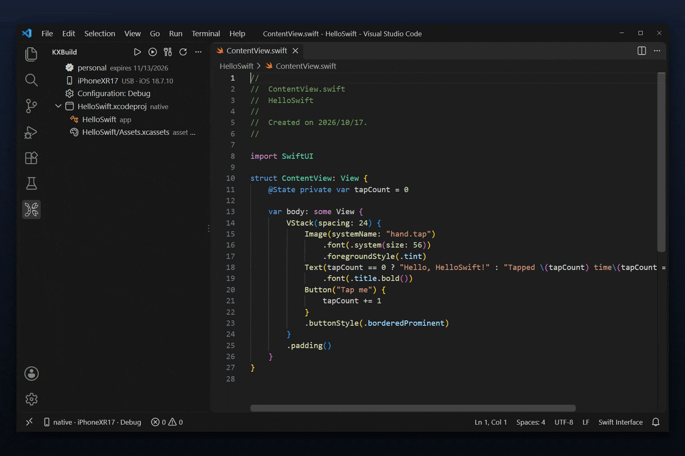

**Build errors in Problems.** Compiler errors and warnings land in the Problems panel; click one to jump to the line.

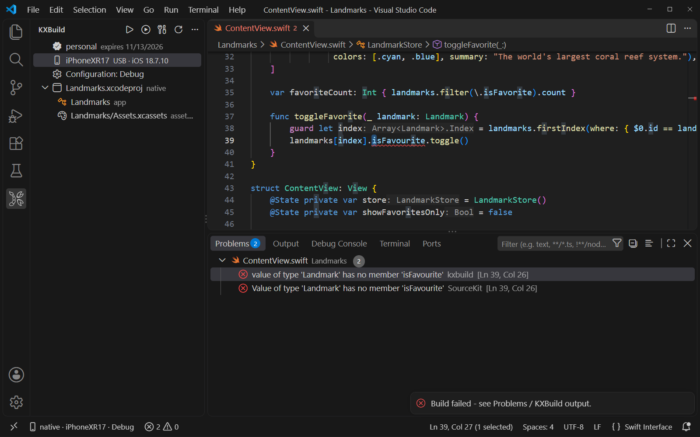

**Release builds to an .ipa.** Switch to Release and click Build. The signed .ipa is written to the project's `build` folder, ready for App Store Connect and TestFlight.

**Run tests on the iPhone.** XCTest and Swift Testing tests appear in the Testing view. Run a test, a class or a whole target on an iOS 17 or later device, with failures shown at the source line.

### Visual editors for Xcode project files

| | |
|---|---|
| **Info.plist**, entitlements and privacy manifests: edit keys, types and values in a table | 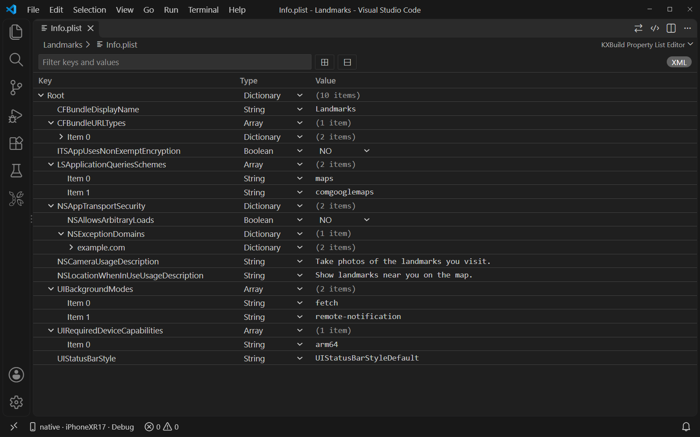 |
| **String Catalogs** (.xcstrings) and .strings tables: languages with translation progress, plural and device variations, sync with source code | 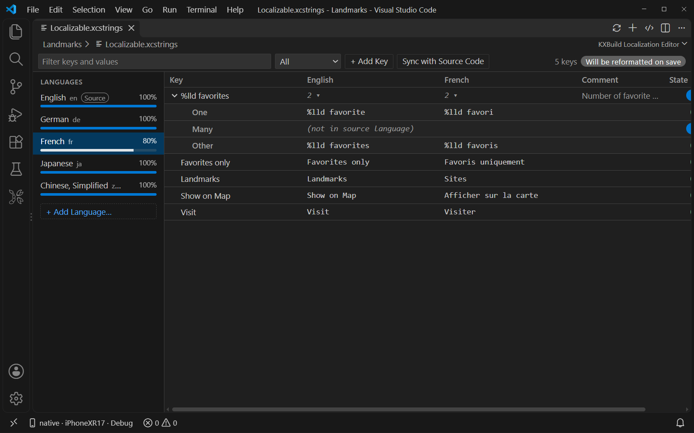 |
| **Project settings**: targets, General and Build Settings with Basic / Customized / All, Combined and Levels views | 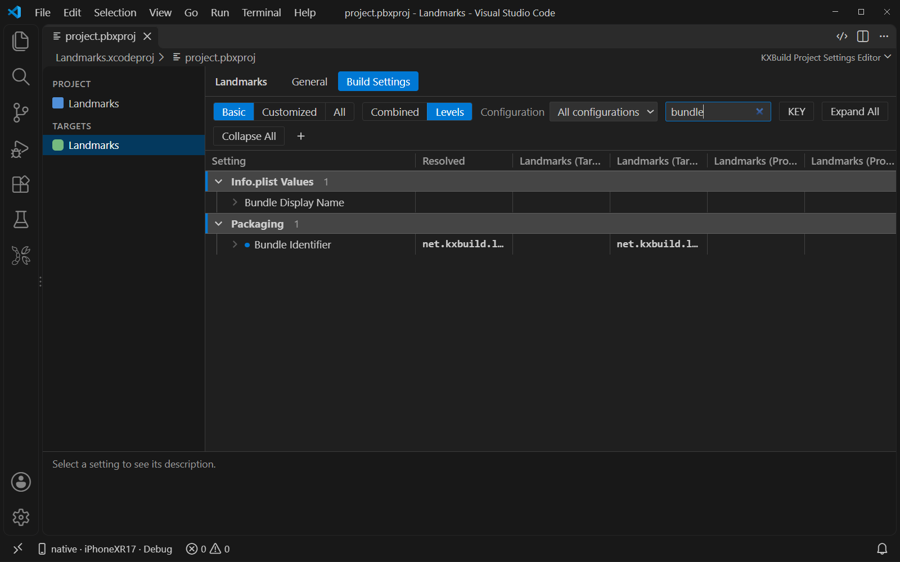 |
| **Asset catalogs** (.xcassets): app icons, colors and images; fill an app icon from one 1024×1024 image | 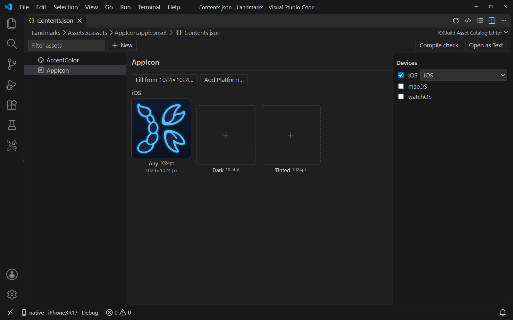 |

Icon Composer `.icon` files open in their own editor too.

## Supported projects

| Project | What you get |
|---|---|
| **Swift / SwiftUI / UIKit**, Swift packages | Build, run, breakpoints, completion, all editors |
| **Objective-C** and mixed Objective-C / Swift | Same as Swift |
| **React Native** | F5 starts Metro, Fast Refresh on save, React Native DevTools for JavaScript, native breakpoints |
| **Godot** (exported Xcode project) | Build, run and debug the exported project on the iPhone |
| **Flutter** | Dart breakpoints, hot reload on save, native breakpoints |
| **Expo**, **uni-app**, **Unity**, **CocoaPods**, **cocos2d-x**, **Cordova**, **Kotlin Multiplatform** | Build, run and debug on the iPhone |

**Objective-C** — stop at a breakpoint and look at `self`:

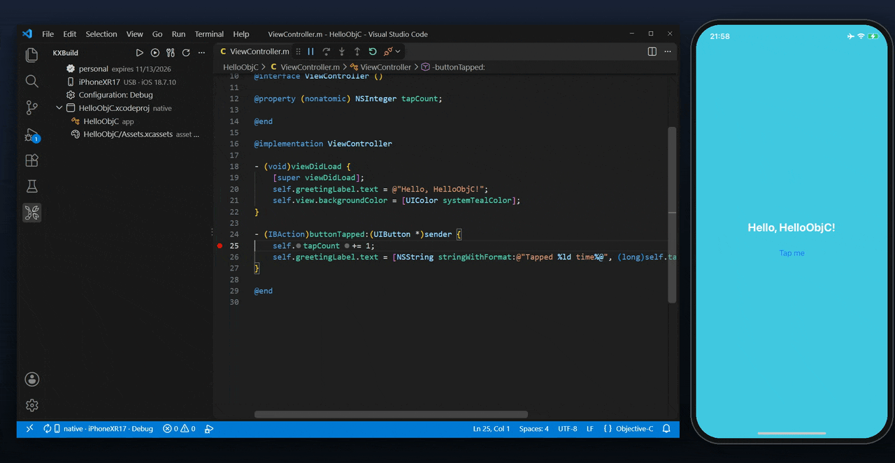

**React Native** — save App.tsx and Fast Refresh updates the phone:

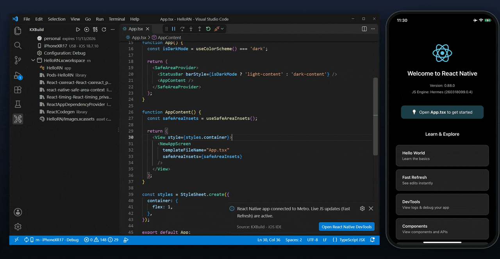

**Godot** — run an exported Godot game on the iPhone:

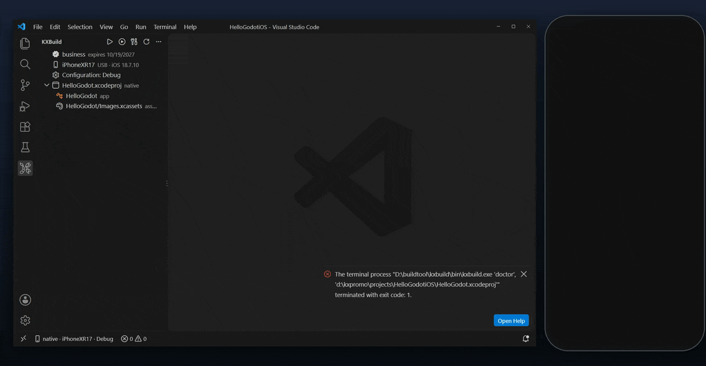

**Flutter** — save main.dart and hot reload updates the phone:

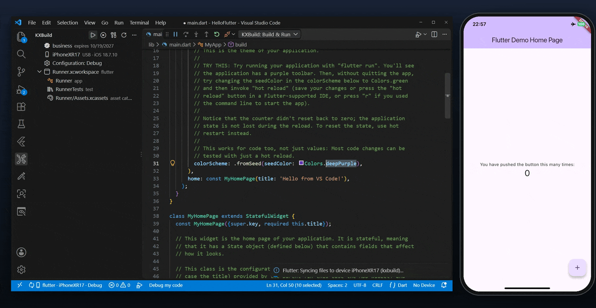

**cocos2d-x** — stop at a C++ breakpoint, then change the scene and run again:

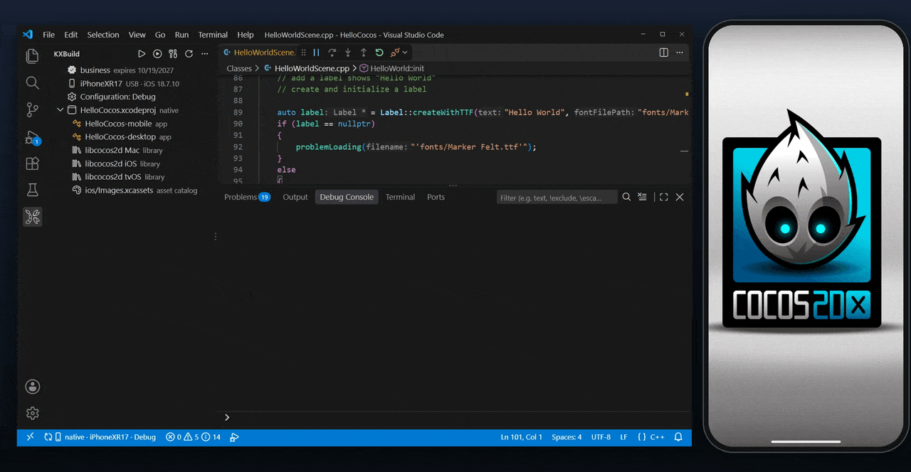

**Cordova** — edit www/index.html, run cordova prepare ios, and run again:

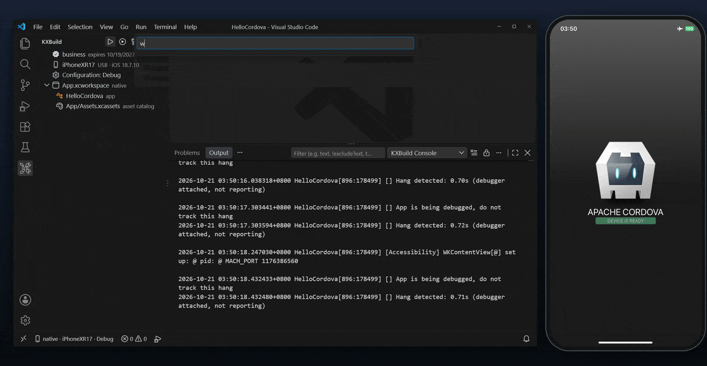

**uni-app** — import an HBuilderX project, then run it on the iPhone:

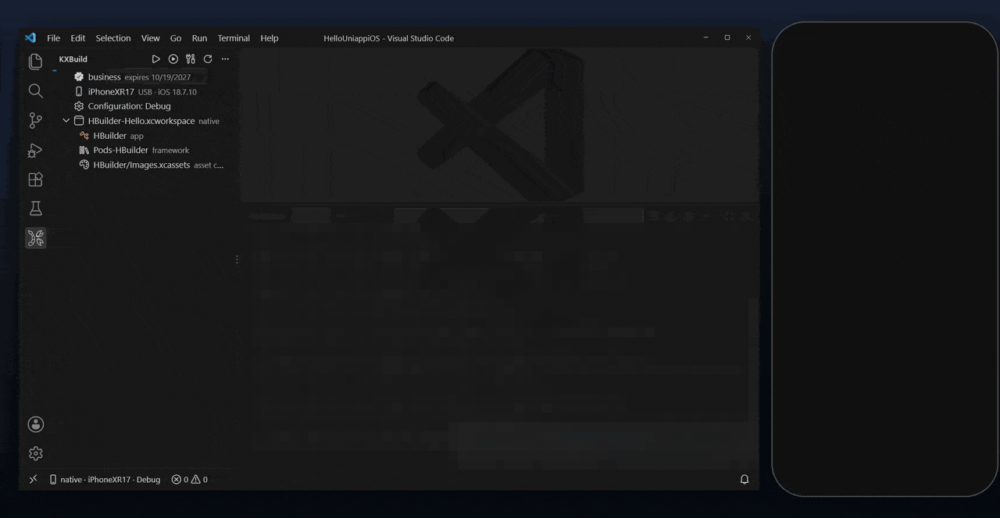

Step-by-step video tutorials for each stack are on [kxbuild.net](https://www.kxbuild.net).

## Getting started

The *Get Started with KXBuild* walkthrough opens after you install the extension. It has four steps:

1. **Set up the toolchain.** Click *Install KXBuild*, then run *KXBuild: Doctor* to check and fix your environment.
2. **Activate your license.** Activate this machine with a code, or start a free trial.
3. **Create or open a project.** Run *KXBuild: New Project*, or open a folder with an .xcodeproj, .xcworkspace or Package.swift.
4. **Select a device, build and debug.** Connect your iPhone over USB, tap *Trust This Computer*, turn on Developer Mode (Settings → Privacy & Security), and press F5.

For signing, put your .p12 certificate, its password file and the .mobileprovision profile in a `keychain` folder in the project. See [Signing](../../README.md#-signing).

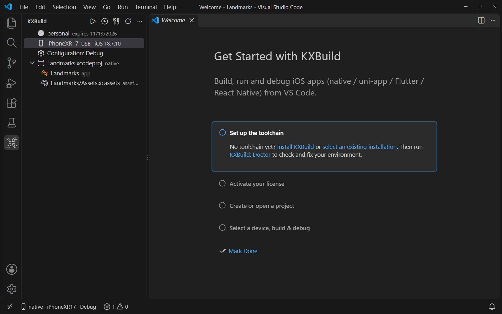

## Use with AI coding agents

KXBuild gives an AI agent the whole loop on Windows, Linux and macOS: build the app, install it on your iPhone, launch it, read its logs, take a screenshot, inspect the view hierarchy, tap and type on the screen, and debug with breakpoints.

- **GitHub Copilot (agent mode) and Cursor**: nothing to set up. The extension registers the KXBuild MCP servers with the agent; the editor's own build, run and debug session are available to Copilot as `#kxbuildBuild`, `#kxbuildRun`, `#kxbuildStack` and friends.
- **Claude Code**: `claude mcp add kxbuild -- kxbuild mcp` and `claude mcp add kxdevice -- kxdevice mcp`.
- **Codex, Windsurf and other MCP clients**: run *KXBuild: Copy MCP Server Configuration for AI Tools* and paste the JSON into the tool's MCP settings.

Then ask the agent to "build and run the app on my iPhone and show me a screenshot".

## FAQ

**Can I develop iOS apps on Windows?**
Yes. KXBuild builds, signs, installs and debugs iOS apps on Windows 10 / 11, on Linux (including WSL) and on macOS. Your Xcode project stays as it is and still opens in Xcode.

**Do I need an Apple Developer account?**
You need a signing certificate (.p12) and a provisioning profile from your Apple Developer account to install apps on an iPhone and to publish them. Without them, the project still builds, unsigned.

**Which iPhones and iOS versions work?**
Any iPhone that runs a supported iOS version, connected over USB. KXBuild is tested on iOS 16 through iOS 26. Debugging on iOS 16 and later needs Developer Mode turned on, and running tests needs iOS 17 or later.

**Can I debug Swift with breakpoints?**
Yes. Breakpoints, stepping, variables and the Debug Console work for Swift and Objective-C, including SwiftUI `@State` values.

**Does it work with React Native and Godot?**
Yes. For React Native, F5 starts Metro, saves apply with Fast Refresh, and React Native DevTools debugs the JavaScript. For Godot, export the project for iOS in the Godot editor, open the exported folder in VS Code and press F5.

**Can I publish to the App Store?**
Yes. A Release build makes a signed .ipa. Upload it to App Store Connect with Transporter or any other upload tool.

**Is the extension free?**
Yes, the extension is free. Builds run on the KXBuild toolchain, which has its own license with a free trial. You can start the trial, activate a license and check its status from the KXBuild view in VS Code.

## Links

- Website and tutorials: [kxbuild.net](https://www.kxbuild.net)
- Command-line guides for every project type: [github.com/kxbuild/kxbuild](../../README.md)
- Report a problem: [Issues](https://github.com/kxbuild/kxbuild/issues)
