# KXBuild — iOS Development for VS Code

**English** · [简体中文](../zh/vscode.md)

> ⚠️ **KXBuild is currently in private beta.** [Sign up](https://www.kxbuild.net/invite?to=register) to join the waitlist — completing your beta access request in your account helps us review it sooner, and we'll email you when your access is ready. You can also ⭐ Star or Watch us on [GitHub](../../README.md) to hear about updates.

Build, run and debug iOS apps on a real iPhone from VS Code — on Windows, Linux and macOS.
Press F5 and your app is built, signed, installed on the iPhone connected over USB, and stopped at your breakpoint.

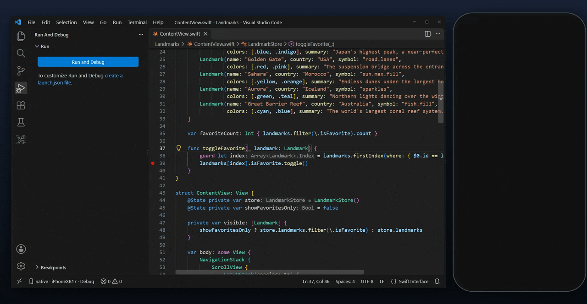

## Features

**Run and debug on a real iPhone.** F5 builds, signs and installs the app, then attaches the debugger. Set breakpoints in Swift and Objective-C, step through code, inspect variables (SwiftUI `@State` included) and use the Debug Console.

**Pick a device and a configuration.** The KXBuild view shows your license, the connected iPhone (USB or Wi-Fi), the Debug / Release configuration and the project's targets. Click a row to change it.

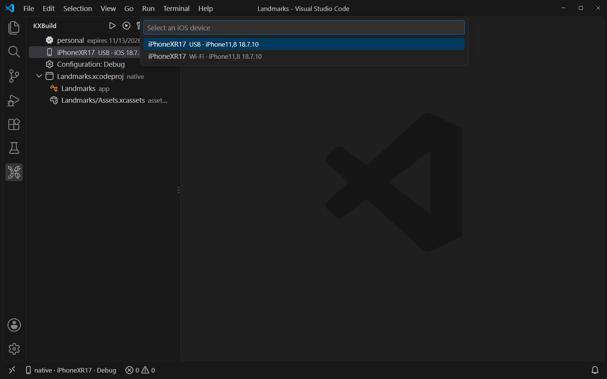

**New projects.** Run *KXBuild: New Project*, pick a SwiftUI, UIKit, Objective-C, React Native, Flutter, Expo or other template, enter a name and a bundle identifier, and the project is ready to run.

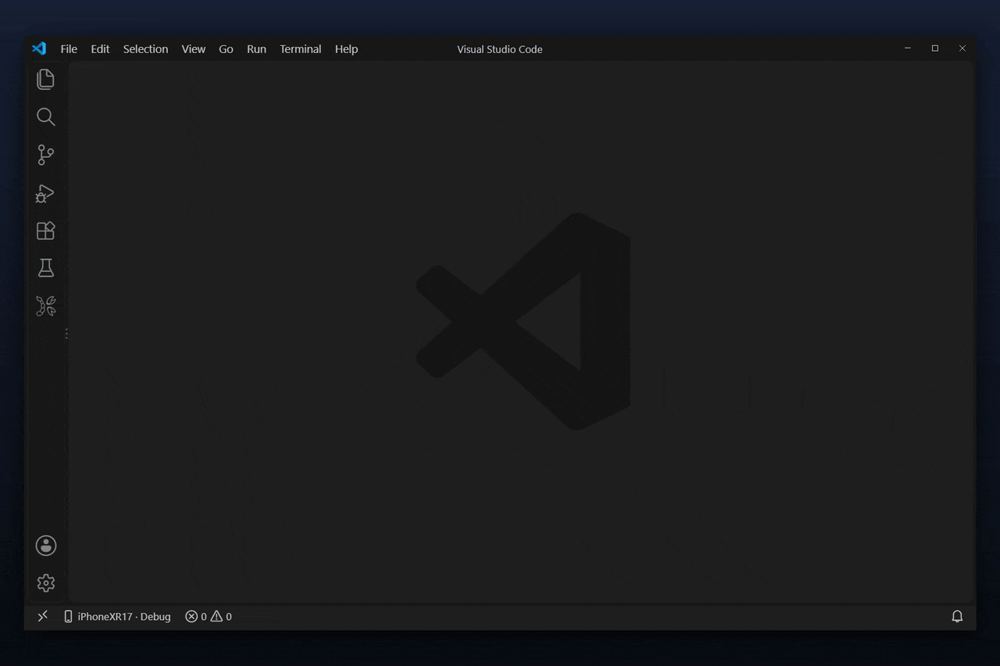

**Smart code completion.** Completion, go to definition and find references for Swift, Objective-C, C and C++.

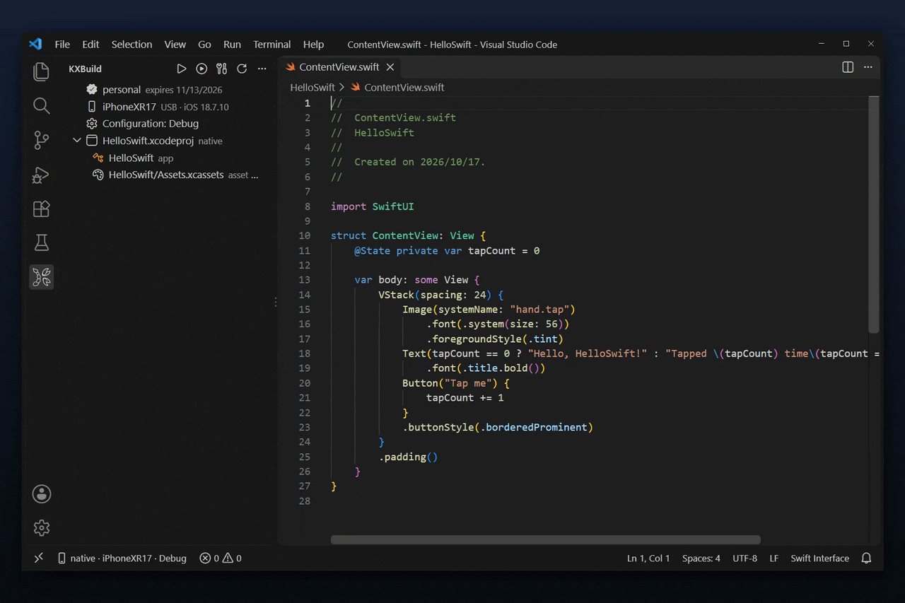

**Jump to errors.** Compile errors and warnings are listed in the Problems panel; click one to jump to the line.

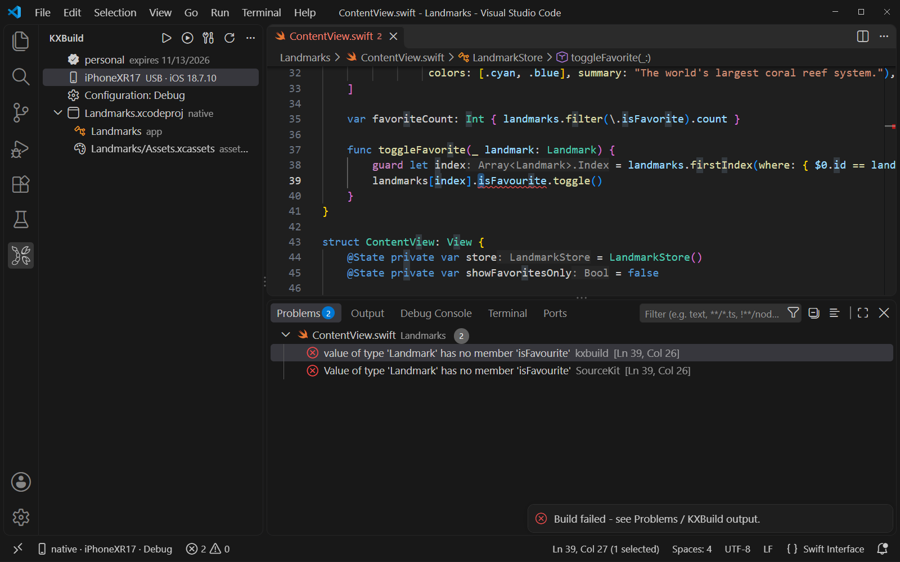

**Package and upload to the App Store.** Run **KXBuild: Build for App Store (.ipa)** from the Command Palette or the project's context menu. It signs the app with your Apple Distribution certificate and App Store profile and writes the .ipa to the project's `build` folder. Then run **KXBuild: Upload to App Store Connect**; on the first upload, choose your App Store Connect API key (create it in App Store Connect under Users and Access → Integrations → Team Keys). The build shows up on the TestFlight tab a few minutes after the upload.

**Run tests on the iPhone.** XCTest and Swift Testing tests appear in the Testing view. Run a test, a class or a whole target on an iOS 17 or later device, with failures shown at the source line.

### Visual editors for Xcode project files

| | |
|---|---|
| **Info.plist**, entitlements and privacy manifests: edit keys, types and values in a table | 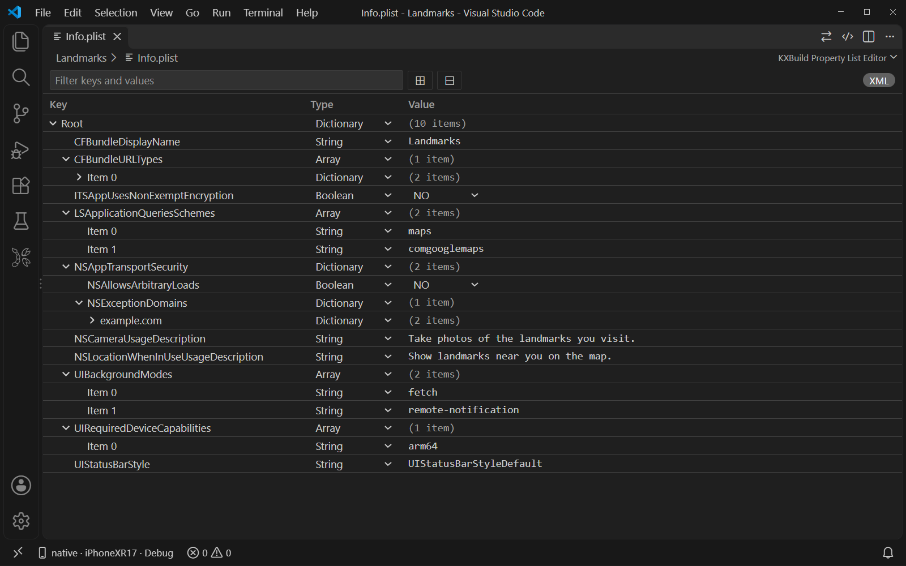 |
| **String Catalogs** (.xcstrings) and .strings tables: languages with translation progress, plural and device variations, sync with source code | 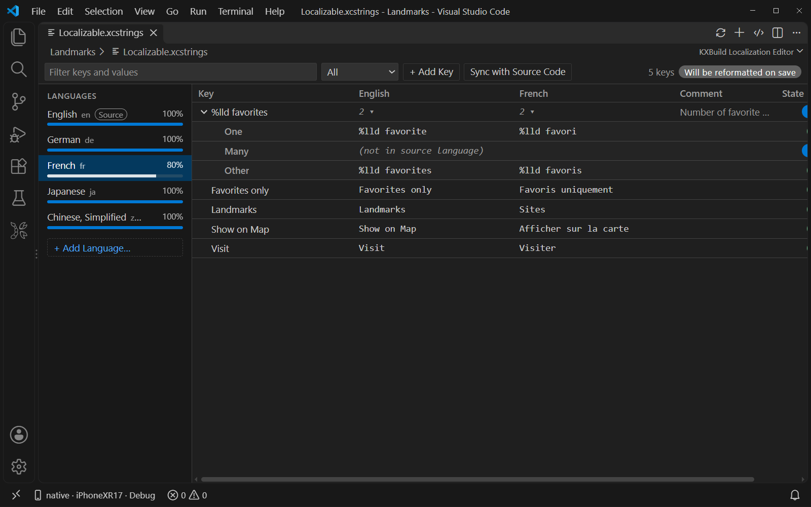 |
| **Project settings**: targets, General and Build Settings with Basic / Customized / All, Combined and Levels views | 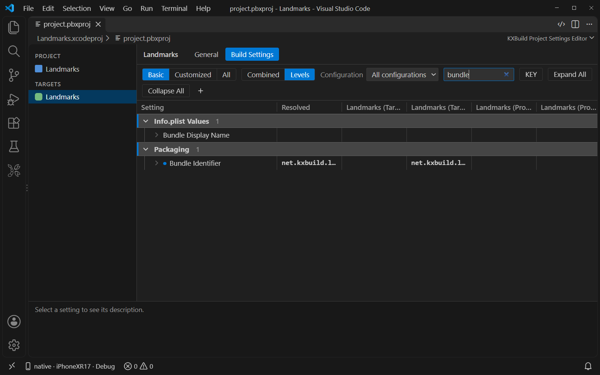 |
| **Asset catalogs** (.xcassets): app icons, colors and images; fill an app icon from one 1024×1024 image | 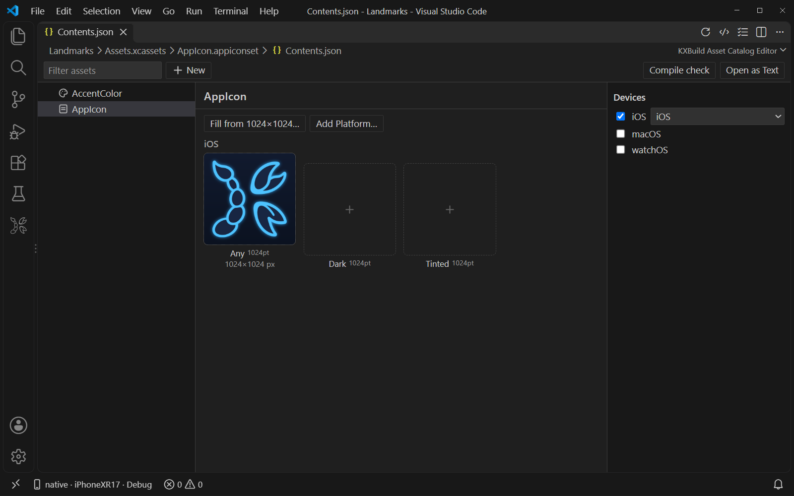 |

Icon Composer `.icon` files open in their own editor too.

## Supported projects

| Project | What you get |
|---|---|
| **Swift / SwiftUI / UIKit**, Swift packages | Build, run, breakpoints, completion, all editors |
| **Objective-C** and mixed Objective-C / Swift | Same as Swift |
| **React Native** | F5 starts Metro, Fast Refresh on save, React Native DevTools for JavaScript, native breakpoints |
| **Godot** (exported Xcode project) | Build, run and debug the exported project on the iPhone |
| **Flutter** | Dart breakpoints, hot reload on save, native breakpoints |
| **Expo**, **uni-app**, **Unity**, **CocoaPods**, **cocos2d-x**, **Cordova**, **Kotlin Multiplatform** | Build, run and debug on the iPhone |
| **Cocos Creator** 3.8 / Cocos 4 | Build the iOS platform, run *KXBuild: Doctor*, then build and run on the iPhone |

**Objective-C** — stop at a breakpoint and look at `self`:

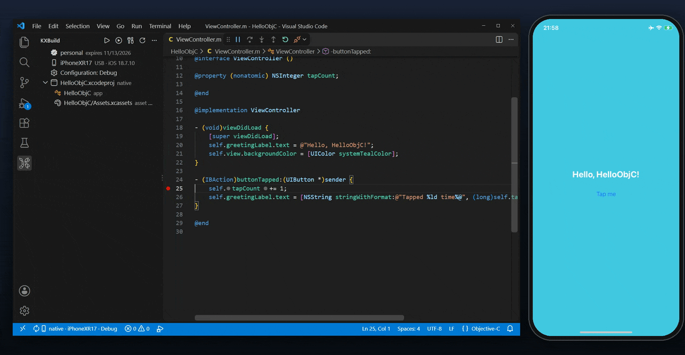

**React Native** — save App.tsx and Fast Refresh updates the phone:

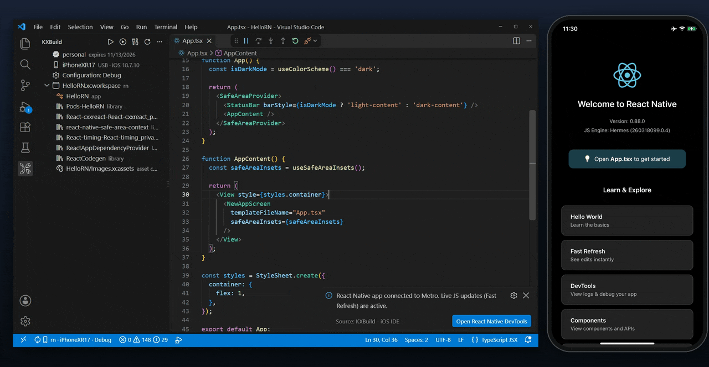

**Godot** — run an exported Godot game on the iPhone:

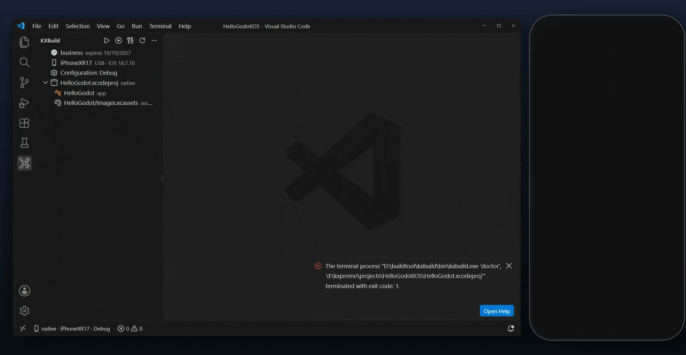

**Flutter** — save main.dart and hot reload updates the phone:

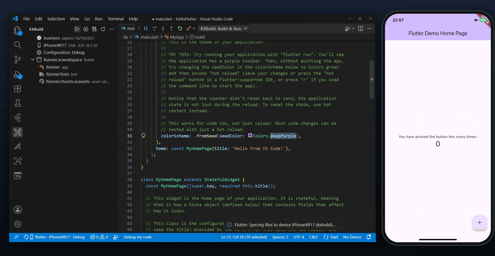

**Cocos Creator** — change a TypeScript script, run cocos build, and run again:

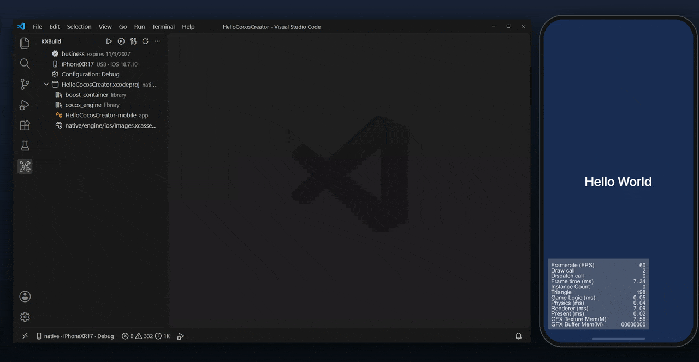

**Cordova** — edit www/index.html, run cordova prepare ios, and run again:

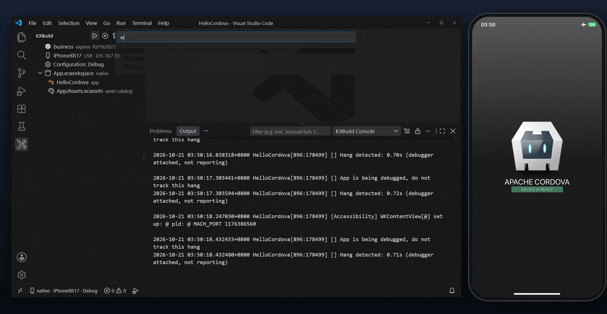

**uni-app** — export the Xcode project with the [HBuilderX plugin](https://www.kxbuild.net/stacks/uni-app.html#hbuilderx), then open it here to run and debug the native layer on the iPhone:

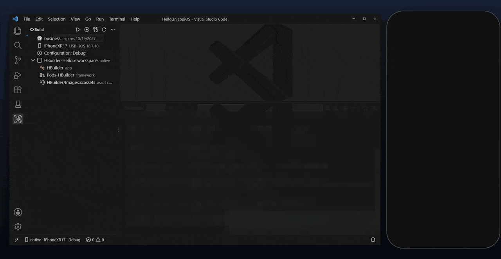

Step-by-step video tutorials for each stack are on [kxbuild.net](https://www.kxbuild.net).

## Getting started

The *Get Started with KXBuild* walkthrough opens after you install the extension. It has four steps:

1. **Set up the toolchain.** Click *Install KXBuild*, then run *KXBuild: Doctor* to check and fix your environment.
2. **Activate your license.** Activate this machine with a code, or start a free trial.
3. **Create or open a project.** Run *KXBuild: New Project*, or open a folder with an .xcodeproj, .xcworkspace or Package.swift.
4. **Select a device, build and debug.** Connect your iPhone over USB, tap *Trust This Computer*, turn on Developer Mode (Settings → Privacy & Security), and press F5.

For signing, put your .p12 certificate, its password file and the .mobileprovision profile in a `keychain` folder in the project. See [Signing](../../README.md#-signing).

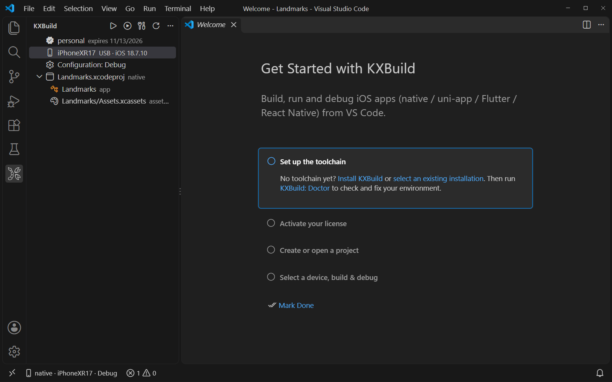

## Use the kxbuild command line

The `kxbuild` and `kxdevice` commands installed in step 1 of the walkthrough work in any terminal, including the VS Code integrated terminal. From a new project to the app running on your iPhone:

```shell
kxbuild project create -t app_swiftui -n MyApp -b com.example.myapp   # create the project in a MyApp folder
cd MyApp                                      # put your certificate and profile in the keychain folder here
kxdevice device list                          # check the iPhone is connected; the first column is the UDID
kxbuild build MyApp.xcodeproj --install       # build, sign and install on the iPhone
kxbuild run MyApp.xcodeproj                   # build, install and launch
```

`kxbuild project templates` lists every template: SwiftUI, UIKit, Objective-C, CocoaPods, Flutter, React Native, Expo, framework and static library.

| Goal | Command |
|---|---|
| Check and repair the environment, upgrade kxbuild | `kxbuild doctor` |
| Prepare a Flutter, React Native, Expo, Kotlin Multiplatform, Cocos Creator or cocos2d-x project before its first build | `kxbuild doctor MyApp.xcworkspace` |
| List schemes, targets and bundle identifiers | `kxbuild project info MyApp.xcodeproj` |
| Build a given scheme and configuration | `kxbuild build MyApp.xcworkspace -s MyApp -c Release` |
| Collect 10 seconds of logs and a screenshot after launch | `kxbuild run MyApp.xcodeproj --wait-logs 10s --screenshot build/run.png` |
| Pick a device when several iPhones are connected | `kxbuild run MyApp.xcodeproj --udid <UDID>` |
| Run tests on the iPhone (iOS 17 or later) | `kxbuild test MyApp.xcodeproj` |
| Add a Swift package | see `kxbuild project add-package --help` |
| Install an existing .ipa on the iPhone | `kxdevice install build/MyApp.ipa` |
| Watch the app's live logs | `kxdevice ostrace --pid <pid>`; `kxdevice syslog` for the system log |
| Build the App Store .ipa | `kxbuild build MyApp.xcodeproj -c Release --export app-store` |
| Upload to App Store Connect | `kxstore build upload build/MyApp.ipa` |

Add `--help` to any command to see all its flags. The full reference is in the [command-line guide](../../README.md).

## Let AI develop with kxbuild

After an AI coding agent writes code, it can check the result itself with KXBuild: build the app, install it on your iPhone, launch it, read its logs, take a screenshot, inspect the view hierarchy, tap and type on the screen, debug with breakpoints, and finally upload to App Store Connect.

### Connect your AI tool

| AI tool | What to do |
|---|---|
| **GitHub Copilot (agent mode), Cursor** | Nothing to set up once the extension is installed |
| **Claude Code** | Run `claude mcp add kxbuild -- kxbuild mcp` and `claude mcp add kxdevice -- kxdevice mcp` in a terminal |
| **Codex, Windsurf and other MCP clients** | Run *KXBuild: Copy MCP Server Configuration for AI Tools* and paste the JSON into the tool's MCP settings |

To let the agent publish the app, also run `kxstore skill --install user` once. The agent then uses `kxstore` to upload builds, fill in metadata and screenshots and manage TestFlight; you keep the decision to submit for review.

### How to have AI use kxbuild

- **Say what you want.** Once connected, ask in plain words, for example "build and run it on my iPhone and show me a screenshot". The agent builds, installs and takes the screenshot on its own.
- **Have the agent run commands.** For an AI tool that is not connected, tell it to use the commands from the previous section with `--json` added, for example `kxbuild run MyApp.xcodeproj --json --wait-logs 10s --screenshot build/run.png`. The agent then reads the exact location of compile errors and the reason for a failure.
- **Name the action in Copilot chat.** Type `#kxbuildBuild` to build, `#kxbuildRun` to run, `#kxbuildProblems` to read compile errors and `#kxbuildConsole` to read the app's output; while the debugger is paused, `#kxbuildStack` and `#kxbuildVariables` show it the call stack and variables. They use the device and configuration selected in the KXBuild view.

A project created with *KXBuild: New Project* or `kxbuild project create` comes with an `AGENTS.md` that lists its build, run and test commands, and agents read it on their own. For an existing project, add one from the template in the [AI coding agents guide](ai-agents.md), which also has the setup details for each AI tool.

### Prompts to start with

Send these to the agent as they are, with your own names filled in:

| Goal | Prompt |
|---|---|
| New project | Create a SwiftUI project named MyApp with kxbuild, bundle identifier com.example.myapp, then build it and run it on my iPhone. |
| Write a feature and check it | Add a pull-to-refresh list to the home screen. When done, build and run it on my iPhone and show me a screenshot. |
| Fix compile errors | Build this project and fix the compile errors one by one until the app launches on the iPhone. |
| See what happens at run time | Run the app, wait 10 seconds, then give me a screenshot and the logs from that time. |
| Drive the UI | In the app, tap "Sign In", type the account test and the password 123456, tap "Submit", and tell me what the screen shows. |
| Find a layout problem | The title on the Settings screen is hidden behind the navigation bar. Inspect the view hierarchy, find the cause, fix it and confirm with a screenshot. |
| Debug with a breakpoint | Set a breakpoint at line 42 of `ContentView.swift`, run the app, and when it stops tell me the value of `items` and the call stack. |
| Find a crash | The app crashes at launch. Read the crash logs on the device, find the cause, fix it and run again to confirm. |
| Add a dependency | Add the Alamofire Swift package to the project with kxbuild and switch the network requests to it. |
| Run tests | Run the tests on the iPhone and fix the failing ones. |
| Publish | Build the App Store .ipa and upload it to App Store Connect. Do not submit it for review yet. |

## Screen readers and keyboard

KXBuild works with NVDA, JAWS, Windows Narrator, Orca and VoiceOver.

- In the Info.plist, String Catalog and Build Settings editors, move between rows with the arrow keys, press **F2** or **Enter** to edit a value and **Delete** to remove a row. The screen reader reads the whole row: key, value and, for translations, their state.
- The KXBuild status bar item and side bar read out the selected device, the build configuration and whether a build is running.
- In a terminal, set `NO_COLOR=1` or `TERM=dumb` to get plain output without colors or progress redraws. Add `--json` to `kxbuild` and `kxdevice` commands for output a script can read.

## Links

- Website and tutorials: [kxbuild.net](https://www.kxbuild.net)
- Command-line guides for every project type: [github.com/kxbuild/kxbuild](../../README.md)
- Report a problem: [Issues](https://github.com/kxbuild/kxbuild/issues)
