# KXBuild — 用 VS Code 开发 iOS 应用

[English](../en/vscode.md) · **简体中文**

> ⚠️ **KXBuild 目前处于内测阶段。** 在官网[注册](https://www.kxbuild.net/invite?to=register)即提交内测申请，在用户中心完善申请资料可以更快通过审核，审核通过后会邮件通知你安装。也欢迎在 [GitHub](../../README.md) 上 ⭐ Star 或 Watch，及时获取更新。

在 VS Code 里构建 iOS 应用、装到 iPhone 真机运行、断点调试，Windows、Linux、macOS 都能用。
按 F5，应用会自动构建、签名、安装到 USB 连接的 iPhone，并停在你设的断点上。

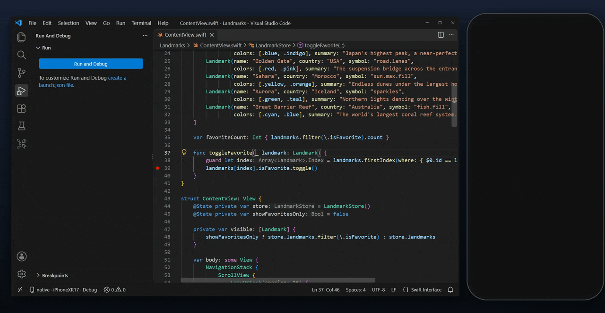

## 功能

**真机运行与调试。** 按 F5 构建、签名、安装并附加调试器。Swift 和 Objective-C 都能打断点、单步执行、查看变量（包括 SwiftUI 的 `@State`），也能在调试控制台里执行命令。

**选择设备和配置。** KXBuild 视图里列出授权、已连接的 iPhone（USB 或 Wi-Fi）、Debug / Release 配置和工程的各个 target，点击对应的行即可切换。

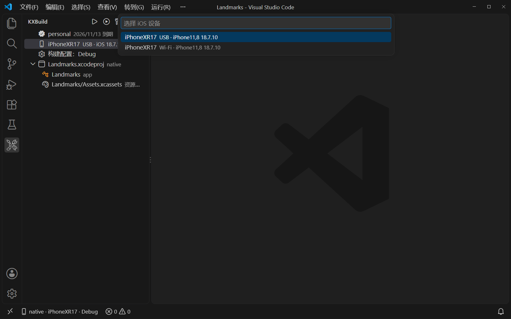

**新建项目。** 运行 *KXBuild: New Project*，选择 SwiftUI、UIKit、Objective-C、React Native、Flutter、Expo 等模板，填好名称和 Bundle ID 就能运行。

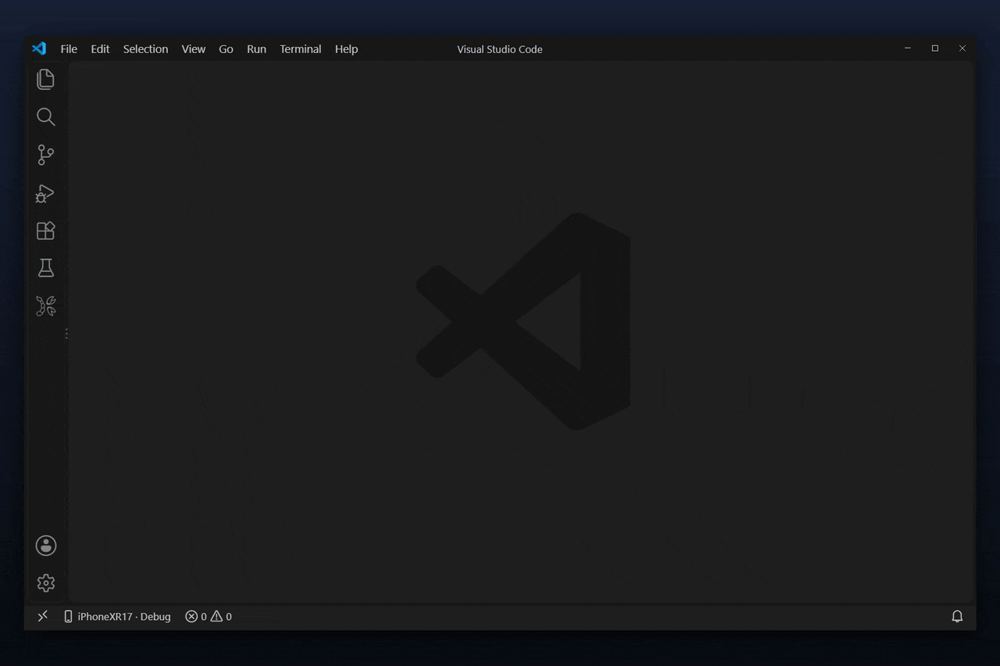

**智能代码补全。** Swift、Objective-C、C、C++ 都支持代码补全、跳转定义和查找引用。

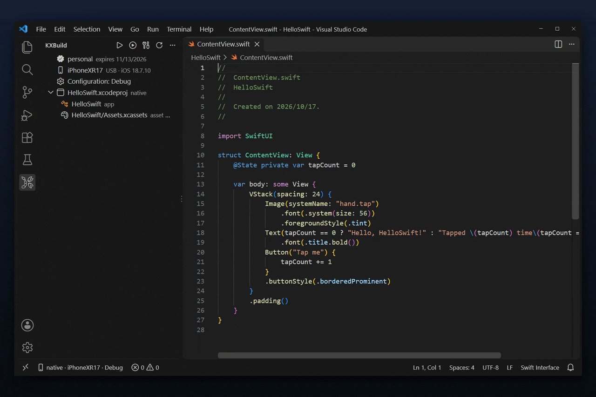

**错误定位。** 编译错误和警告列在“问题”面板里，点一下就跳到对应的代码行。

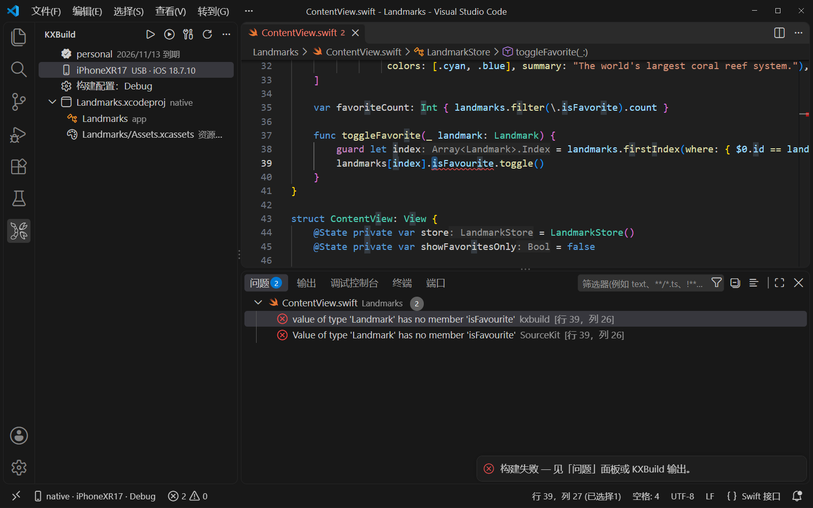

**打包并上传 App Store。** 在命令面板或工程右键菜单运行 **KXBuild: 生成 App Store ipa**，用你的 Apple Distribution 证书和 App Store 描述文件签名，.ipa 生成在项目的 `build` 目录。再运行 **KXBuild: 上传到 App Store Connect**，首次上传时选择你的 App Store Connect API 密钥（在 App Store Connect 的 用户和访问 → 集成 → 团队密钥 里创建）。上传后几分钟，构建出现在 TestFlight 页。

**在 iPhone 上跑测试。** XCTest 和 Swift Testing 用例会出现在“测试”视图里。可以在 iOS 17 及以上的设备上运行单个用例、一个类或整个测试 target，失败信息会标在对应的源码行上。

### Xcode 工程文件的可视化编辑

| | |
|---|---|
| **Info.plist**、entitlements 和隐私清单：在表格里编辑 Key、类型和值 | 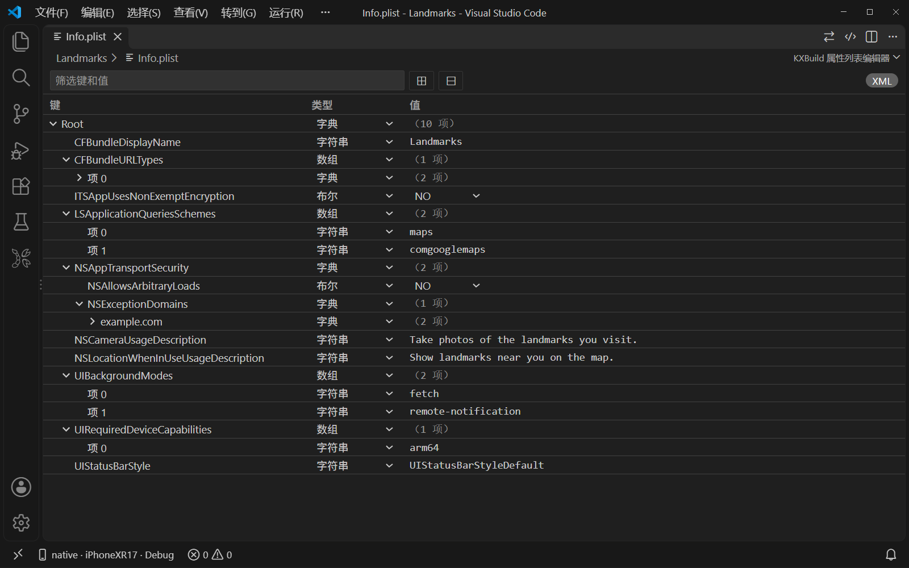 |
| **String Catalog**（.xcstrings）和 .strings 表：按语言显示翻译进度，支持复数和设备变体，可从源码同步 key | 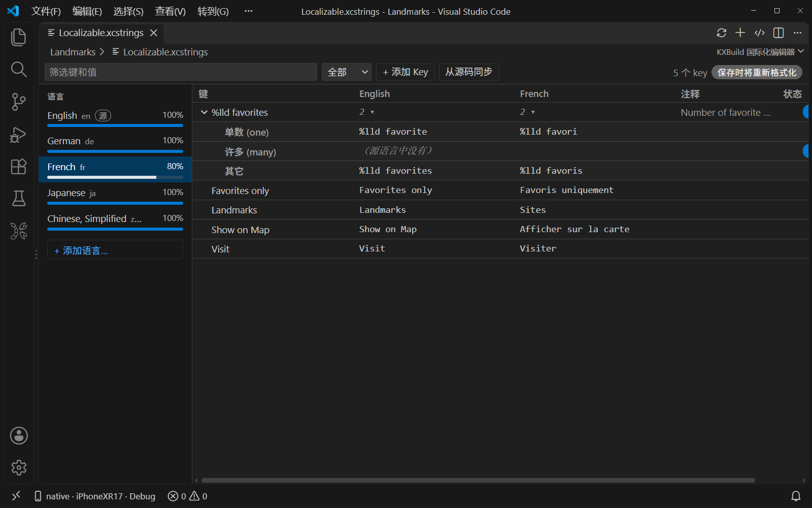 |
| **工程设置**：target、通用、构建设置，支持基本 / 已自定义 / 全部，以及合并和层级视图 | 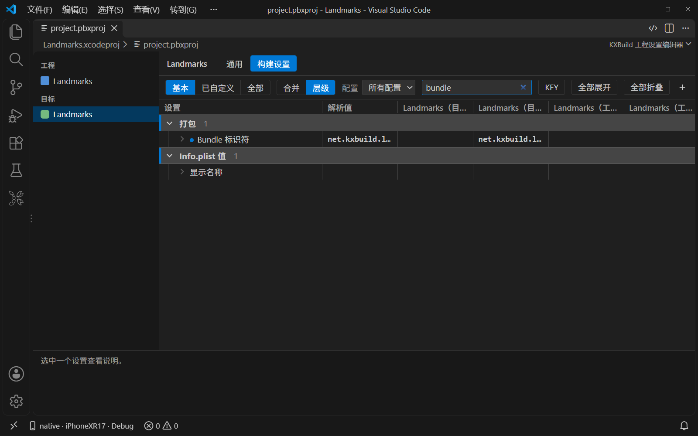 |
| **资源目录**（.xcassets）：App 图标、颜色和图片，用一张 1024×1024 的图就能填满 App 图标 | 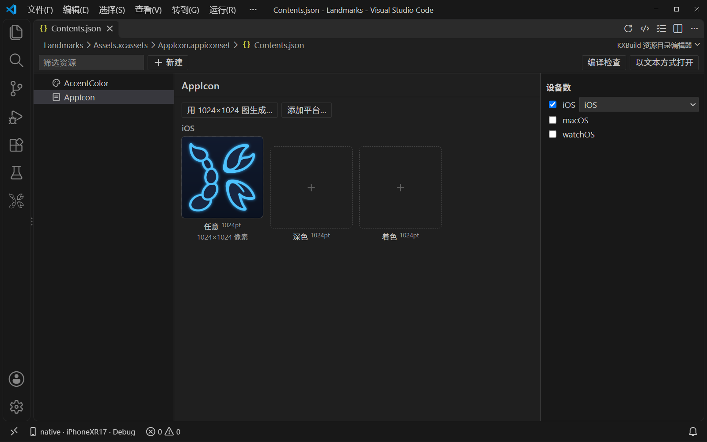 |

Icon Composer 的 `.icon` 文件也有专门的编辑器。

## 支持的项目

| 项目类型 | 能做什么 |
|---|---|
| **Swift / SwiftUI / UIKit**、Swift 包 | 构建、运行、断点调试、代码补全、所有可视化编辑器 |
| **Objective-C**，以及 Objective-C / Swift 混编 | 同 Swift |
| **React Native** | 按 F5 自动启动 Metro，保存即热更新，用 React Native DevTools 调试 JavaScript，也支持原生断点 |
| **Godot**（导出的 Xcode 工程） | 在 iPhone 上构建、运行、调试导出的工程 |
| **Flutter** | Dart 断点，保存即热重载，也支持原生断点 |
| **Expo**、**uni-app**、**Unity**、**CocoaPods**、**cocos2d-x**、**Cordova**、**Kotlin Multiplatform** | 在 iPhone 上构建、运行、调试 |
| **Cocos Creator** 3.8 / Cocos 4 | 先构建 iOS 平台，再运行 *KXBuild: Doctor*，然后在 iPhone 上构建、运行 |

**Objective-C**：停在断点上，查看 `self` 的变量：

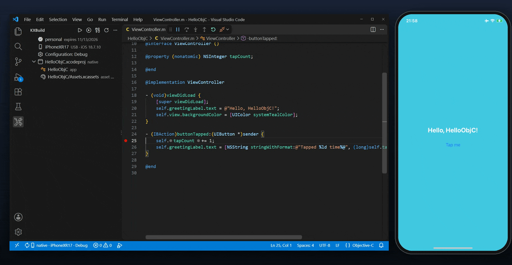

**React Native**：保存 App.tsx，手机上立刻热更新：

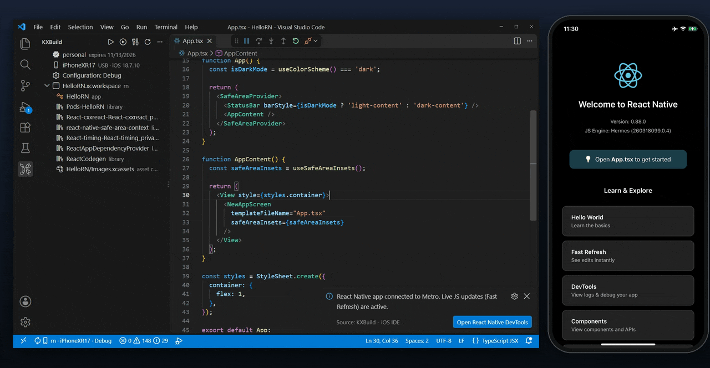

**Godot**：把导出的 Godot 游戏跑在 iPhone 上：

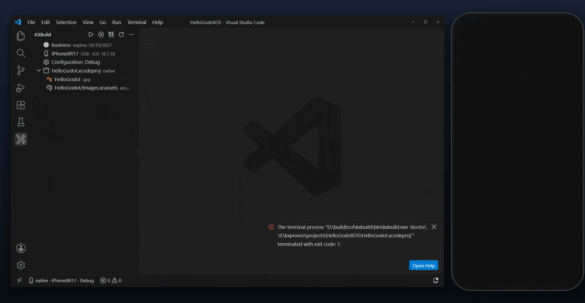

**Flutter**：保存 main.dart，手机上立即热重载：

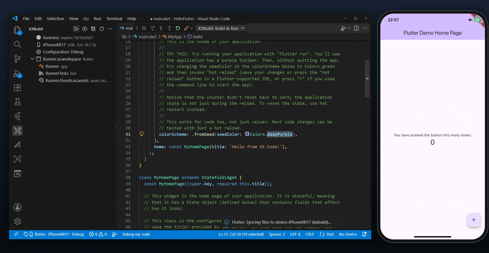

**Cocos Creator**：修改 TypeScript 脚本，运行 cocos build 后再运行：

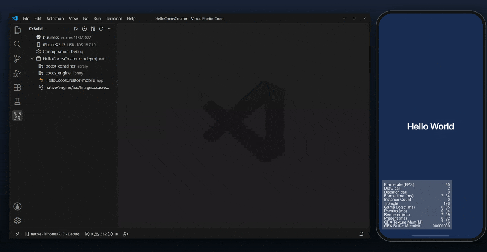

**Cordova**：修改 www/index.html，运行 cordova prepare ios 后再运行：

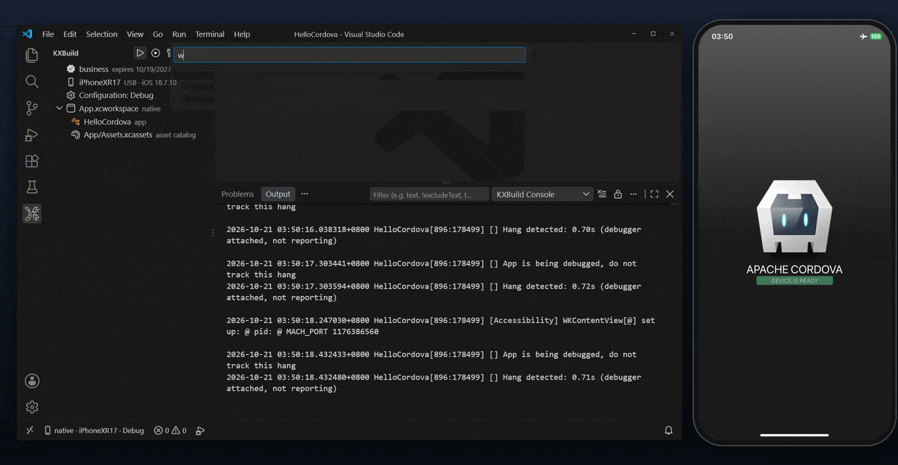

**uni-app**：用 [HBuilderX 插件](https://www.kxbuild.net/zh/stacks/uni-app.html#hbuilderx)导出 Xcode 工程，在这里打开后到 iPhone 上运行，并调试原生层：

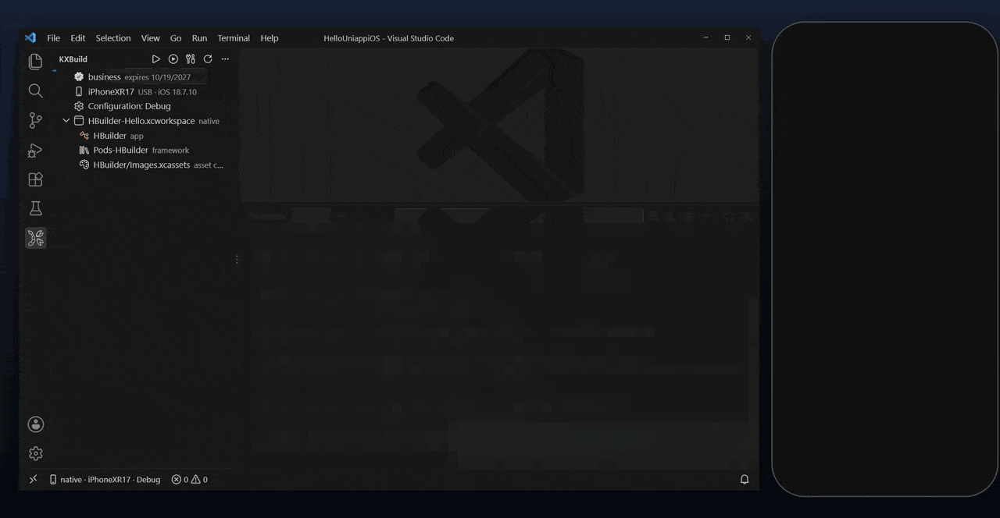

各技术栈的分步视频教程见 [kxbuild.net](https://www.kxbuild.net)。

## 快速上手

装好插件后会打开“KXBuild 快速上手”向导，共四步：

1. **配置工具链。** 点击“安装 KXBuild”，然后运行 *KXBuild: Doctor* 检查并修复环境。
2. **激活授权。** 用激活码激活本机，或开始免费试用。
3. **新建或打开项目。** 运行 *KXBuild: New Project*，或打开包含 .xcodeproj、.xcworkspace 或 Package.swift 的文件夹。
4. **选设备、构建、调试。** 用 USB 连接 iPhone，在手机上点“信任此电脑”，打开开发者模式（设置 → 隐私与安全性），然后按 F5。

签名方面，把 .p12 证书、它的密码文件和 .mobileprovision 描述文件放进项目里的 `keychain` 文件夹即可，详见[签名](../../README_zh.md#-签名)。

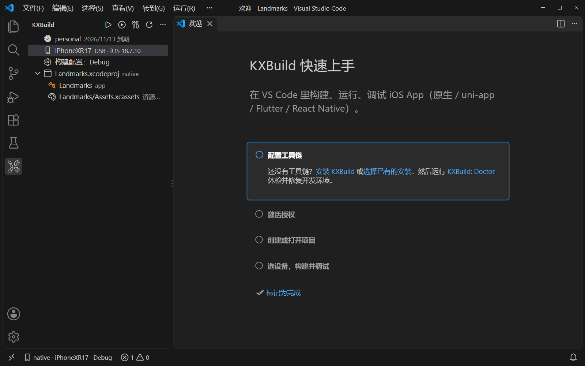

## 在终端里用 kxbuild 命令行

快速上手第 1 步装好的 `kxbuild` 和 `kxdevice` 在任何终端里都能用，包括 VS Code 的集成终端。从新建项目到在 iPhone 上运行：

```shell
kxbuild project create -t app_swiftui -n MyApp -b com.example.myapp   # 新建项目，生成 MyApp 文件夹
cd MyApp                                      # 把证书和描述文件放进这里的 keychain 文件夹
kxdevice device list                          # 确认 iPhone 已连接，第一列是 UDID
kxbuild build MyApp.xcodeproj --install       # 构建、签名并安装到 iPhone
kxbuild run MyApp.xcodeproj                   # 构建、安装并启动
```

`kxbuild project templates` 列出全部模板：SwiftUI、UIKit、Objective-C、CocoaPods、Flutter、React Native、Expo、Framework 和静态库。

| 目标 | 命令 |
|---|---|
| 检查并修复环境、升级 kxbuild | `kxbuild doctor` |
| 首次构建 Flutter、React Native、Expo、Kotlin Multiplatform、Cocos Creator、cocos2d-x 项目前，先准备项目 | `kxbuild doctor MyApp.xcworkspace` |
| 列出 Scheme、Target 和 Bundle ID | `kxbuild project info MyApp.xcodeproj` |
| 指定 Scheme 和配置构建 | `kxbuild build MyApp.xcworkspace -s MyApp -c Release` |
| 启动后收集 10 秒日志并截图 | `kxbuild run MyApp.xcodeproj --wait-logs 10s --screenshot build/run.png` |
| 连了多台 iPhone 时指定设备 | `kxbuild run MyApp.xcodeproj --udid <UDID>` |
| 在 iPhone 上跑测试（iOS 17 及以上） | `kxbuild test MyApp.xcodeproj` |
| 添加 Swift Package | `kxbuild project add-package --help` 查看用法 |
| 把已有的 .ipa 装到 iPhone | `kxdevice install build/MyApp.ipa` |
| 看应用的实时日志 | `kxdevice ostrace --pid <pid>`，系统日志用 `kxdevice syslog` |
| 生成 App Store .ipa | `kxbuild build MyApp.xcodeproj -c Release --export app-store` |
| 上传到 App Store Connect | `kxstore build upload build/MyApp.ipa` |

每条命令都可以加 `--help` 查看全部参数，完整的命令说明见[命令行指南](../../README_zh.md)。

## 让 AI 用 kxbuild 开发

AI 编码代理写完代码后，可以用 KXBuild 自己验证：构建应用、装到 iPhone 上、启动、读日志、截图、查看视图层级、在屏幕上点按和输入、用断点调试，最后上传到 App Store Connect。

### 接入

| AI 工具 | 做法 |
|---|---|
| **GitHub Copilot（代理模式）、Cursor** | 不用配置，装好插件即可 |
| **Claude Code** | 在终端执行 `claude mcp add kxbuild -- kxbuild mcp` 和 `claude mcp add kxdevice -- kxdevice mcp` |
| **Codex、Windsurf 和其他 MCP 客户端** | 运行 *KXBuild: 复制给 AI 工具用的 MCP 服务器配置*，把 JSON 粘贴到工具的 MCP 设置里 |

要让代理上架应用，再执行一次 `kxstore skill --install user`，代理就会用 `kxstore` 上传构建、填写元数据和截图、管理 TestFlight；是否提审由你决定。

### 怎么让 AI 使用 kxbuild

- **直接说要做什么。** 接入后用平常的话提要求，例如“构建并装到我的 iPhone 上运行，截图给我看”，代理会自己完成构建、安装、截图这些操作。
- **让代理执行命令。** 没有接入的 AI 工具，告诉它用上一节的命令并加上 `--json`，例如 `kxbuild run MyApp.xcodeproj --json --wait-logs 10s --screenshot build/run.png`，代理就能准确读到编译错误的位置和失败原因。
- **在 Copilot 对话里指定操作。** 输入 `#kxbuildBuild` 构建、`#kxbuildRun` 运行、`#kxbuildProblems` 读编译错误、`#kxbuildConsole` 读应用输出；调试暂停时用 `#kxbuildStack` 和 `#kxbuildVariables` 让它看调用栈和变量。用的是你在 KXBuild 视图里选中的设备和配置。

用 *KXBuild: New Project* 或 `kxbuild project create` 新建的项目自带 `AGENTS.md`，里面写好了该项目的构建、运行、测试命令，代理会自己读。已有项目照着 [AI 编码代理指南](ai-agents.md)里的模板加一个，各 AI 工具的详细接入方法也在那里。

### 常用提示词

把下面的话直接发给代理，按你的项目改掉名称：

| 想做的事 | 提示词 |
|---|---|
| 新建项目 | 用 kxbuild 新建一个 SwiftUI 项目 MyApp，Bundle ID 是 com.example.myapp，构建并装到我的 iPhone 上运行。 |
| 写功能并验证 | 给首页加一个下拉刷新的列表。写完后构建并装到我的 iPhone 上运行，截图给我看效果。 |
| 修编译错误 | 构建这个项目，把编译错误逐个修掉，直到能在 iPhone 上启动为止。 |
| 看运行结果 | 运行应用，等 10 秒，把截图和这段时间的日志给我。 |
| 操作界面 | 在应用里点“登录”，输入账号 test 和密码 123456，再点“提交”，告诉我屏幕上显示了什么。 |
| 查界面问题 | 设置页的标题被导航栏挡住了。看一下视图层级，找出原因并修好，再截图确认。 |
| 断点调试 | 在 `ContentView.swift` 第 42 行下断点，运行应用，停下来时告诉我 `items` 的值和调用栈。 |
| 查闪退 | 应用一启动就闪退。读设备上的崩溃日志，找到原因并修复，然后重新运行确认。 |
| 加依赖 | 用 kxbuild 给项目加上 Alamofire 这个 Swift Package，并把网络请求改成用它。 |
| 跑测试 | 在 iPhone 上跑一遍测试，把失败的用例修好。 |
| 上架 | 生成 App Store 的 .ipa 并上传到 App Store Connect，先不要提审。 |

## 读屏软件与键盘操作

KXBuild 支持 NVDA、JAWS、Windows 讲述人、Orca 和 VoiceOver。

- 在 Info.plist、String Catalog 和 Build Settings 编辑器里，用方向键在行之间移动，按 **F2** 或 **Enter** 编辑值，按 **Delete** 删除行。读屏软件会读出整行内容：键、值，翻译还会读出翻译状态。
- KXBuild 的状态栏和侧栏会读出当前设备、构建配置以及是否正在构建。
- 在终端里设置 `NO_COLOR=1` 或 `TERM=dumb`，输出就是不带颜色、不原地刷新进度的纯文本。给 `kxbuild` 和 `kxdevice` 命令加上 `--json`，可以得到便于脚本读取的输出。

## 链接

- 官网与教程：[kxbuild.net](https://www.kxbuild.net)
- 各类项目的命令行指南：[github.com/kxbuild/kxbuild](../../README_zh.md)
- 反馈问题：[Issues](https://github.com/kxbuild/kxbuild/issues)
