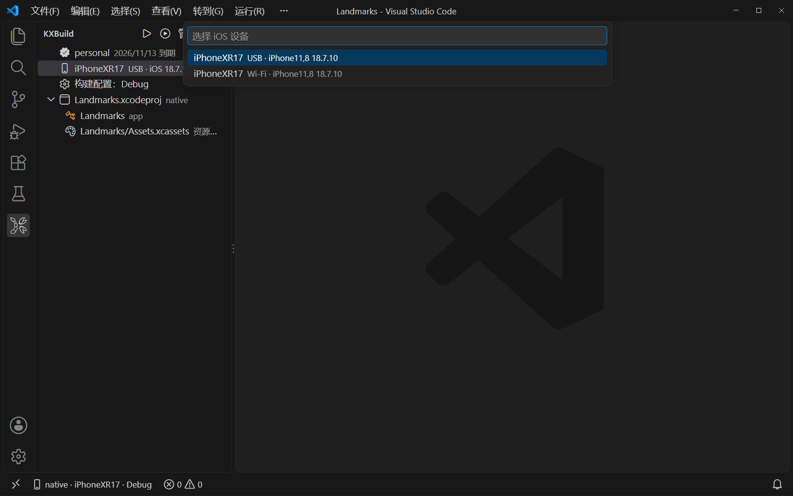
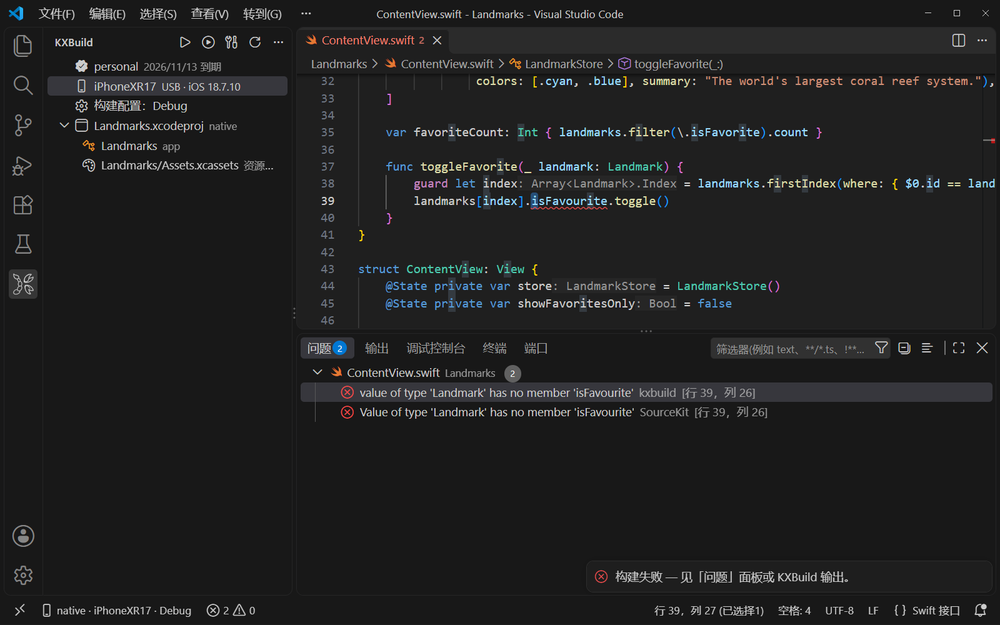
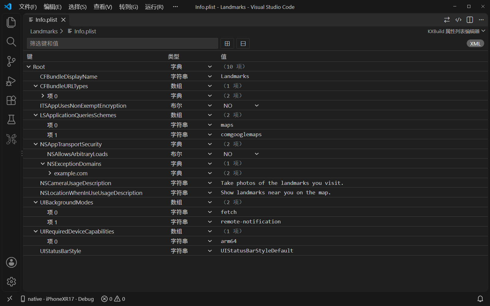
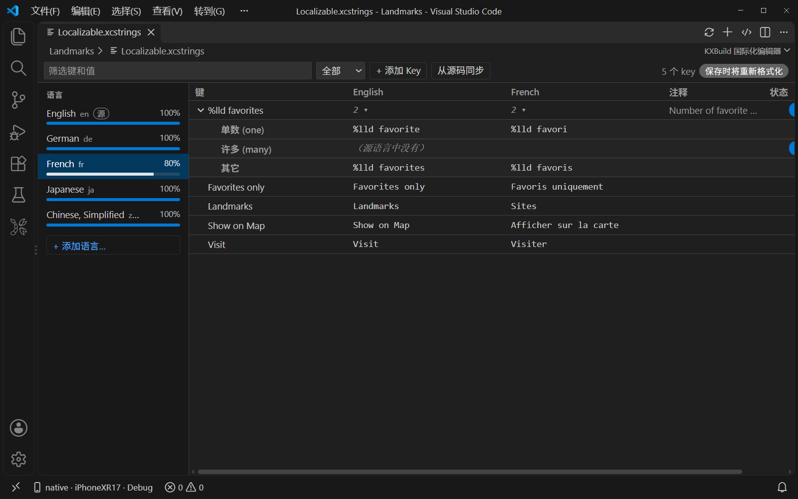
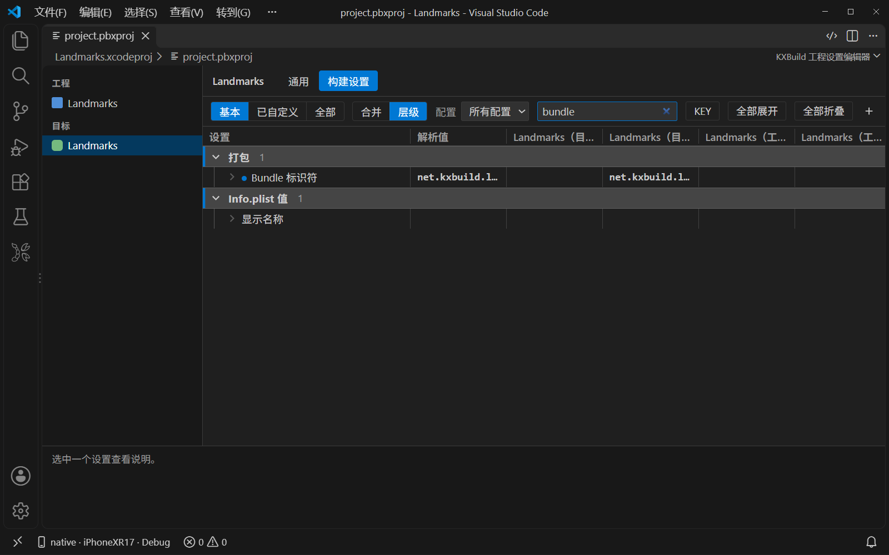
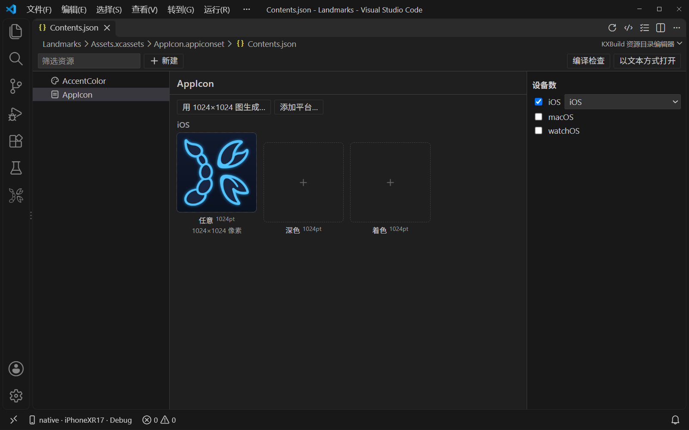
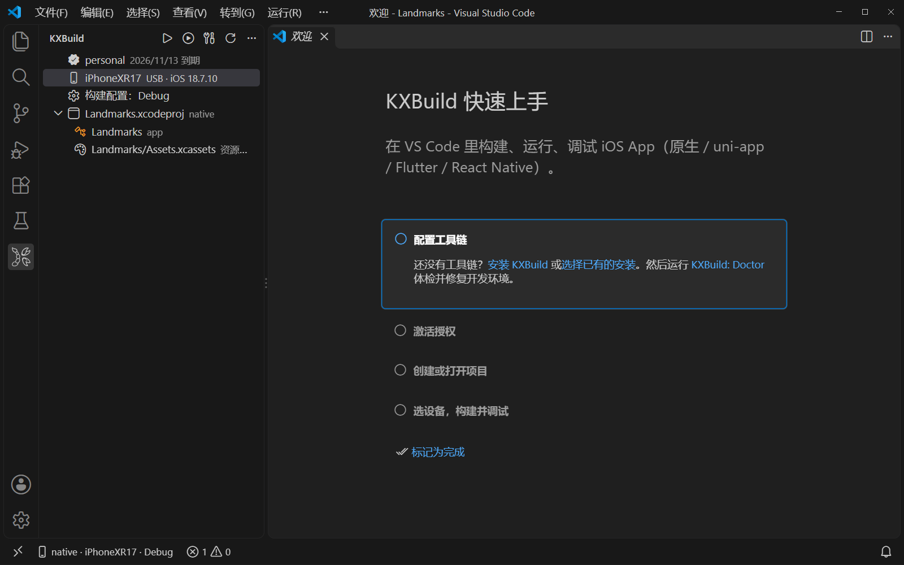

# KXBuild — 用 VS Code 开发 iOS 应用

[English](../en/vscode.md) · **简体中文**

> ⚠️ **KXBuild 目前处于注册测试阶段，未受邀请请暂时不要安装。** 想参与测试，请发邮件至 admin@kxbuild.net 或加 QQ 877028320。也欢迎在 [GitHub](https://github.com/kxbuild/kxbuild) 上 ⭐ Star 或 Watch，第一时间获取正式发布消息。

在 VS Code 里构建 iOS 应用、装到 iPhone 真机运行、断点调试，Windows、Linux、macOS 都能用。
按 F5，应用会自动构建、签名、安装到 USB 连接的 iPhone，并停在你设的断点上。

## 功能

**真机运行与调试。** 按 F5 构建、签名、安装并附加调试器。Swift 和 Objective-C 都能打断点、单步执行、查看变量（包括 SwiftUI 的 `@State`），也能在调试控制台里执行命令。

**选择设备和配置。** KXBuild 视图里列出授权、已连接的 iPhone（USB 或 Wi-Fi）、Debug / Release 配置和工程的各个 target，点击对应的行即可切换。

**几步新建项目。** 运行 *KXBuild: New Project*，可选 SwiftUI、UIKit、Objective-C、React Native、Flutter、Expo 等模板，建好后直接打开，马上就能运行。

**不用先编译就有代码补全。** 工程一打开，Swift、Objective-C、C、C++ 的补全、跳转定义和查找引用就能用。

**编译错误进“问题”面板。** 编译器的错误和警告都列在“问题”面板里，点一下就跳到对应的代码行。

**一条命令出 App Store .ipa。** 在命令面板或工程右键菜单运行 **KXBuild: 生成 App Store ipa**，用你的 Apple Distribution 证书和 App Store 描述文件签名 Release 构建，.ipa 生成在项目的 `build` 目录，可以直接上传 App Store Connect 和 TestFlight。

**在 iPhone 上跑测试。** XCTest 和 Swift Testing 用例会出现在“测试”视图里。可以在 iOS 17 及以上的设备上运行单个用例、一个类或整个测试 target，失败信息会标在对应的源码行上。

### Xcode 工程文件的可视化编辑

| | |
|---|---|
| **Info.plist**、entitlements 和隐私清单：在表格里编辑 Key、类型和值 |  |
| **String Catalog**（.xcstrings）和 .strings 表：按语言显示翻译进度，支持复数和设备变体，可从源码同步 key |  |
| **工程设置**：target、通用、构建设置，支持基本 / 已自定义 / 全部，以及合并和层级视图 |  |
| **资源目录**（.xcassets）：App 图标、颜色和图片，用一张 1024×1024 的图就能填满 App 图标 |  |

Icon Composer 的 `.icon` 文件也有专门的编辑器。

## 支持的项目

| 项目类型 | 能做什么 |
|---|---|
| **Swift / SwiftUI / UIKit**、Swift 包 | 构建、运行、断点调试、代码补全、所有可视化编辑器 |
| **Objective-C**，以及 Objective-C / Swift 混编 | 同 Swift |
| **React Native** | 按 F5 自动启动 Metro，保存即热更新，用 React Native DevTools 调试 JavaScript，也支持原生断点 |
| **Godot**（导出的 Xcode 工程） | 在 iPhone 上构建、运行、调试导出的工程 |
| **Flutter** | Dart 断点，保存即热重载，也支持原生断点 |
| **Expo**、**uni-app**、**Unity**、**CocoaPods**、**cocos2d-x**、**Cordova**、**Kotlin Multiplatform** | 在 iPhone 上构建、运行、调试 |

**Objective-C**：停在断点上，查看 `self` 的变量：

**React Native**：保存 App.tsx，手机上立刻热更新：

**Godot**：把导出的 Godot 游戏跑在 iPhone 上：

**Flutter**：保存 main.dart，手机上立即热重载：

**cocos2d-x**：停在 C++ 断点上查看变量，修改场景后再运行：

**Cordova**：修改 www/index.html，运行 cordova prepare ios 后再运行：

**uni-app**：导入 HBuilderX 项目，在 iPhone 上运行：

各技术栈的分步视频教程见 [kxbuild.net](https://www.kxbuild.net)。

## 快速上手

装好插件后会打开“KXBuild 快速上手”向导，共四步：

1. **配置工具链。** 点击“安装 KXBuild”，然后运行 *KXBuild: Doctor* 检查并修复环境。
2. **激活授权。** 用激活码激活本机，或开始免费试用。
3. **新建或打开项目。** 运行 *KXBuild: New Project*，或打开包含 .xcodeproj、.xcworkspace 或 Package.swift 的文件夹。
4. **选设备、构建、调试。** 用 USB 连接 iPhone，在手机上点“信任此电脑”，打开开发者模式（设置 → 隐私与安全性），然后按 F5。

签名方面，把 .p12 证书、它的密码文件和 .mobileprovision 描述文件放进项目里的 `keychain` 文件夹即可，详见[签名](../../README_zh.md#-签名)。

## 配合 AI 编码代理使用

在 Windows、Linux 和 macOS 上，KXBuild 把整条链路交给 AI 代理：构建应用、装到 iPhone 上、启动、读日志、截图、查看视图层级、在屏幕上点按和输入、用断点调试。

- **GitHub Copilot（代理模式）和 Cursor**：不用配置。插件会把 KXBuild 的 MCP 服务器注册给代理；编辑器自己的构建、运行和调试会话也能让 Copilot 调用，名字是 `#kxbuildBuild`、`#kxbuildRun`、`#kxbuildStack` 等。
- **Claude Code**：`claude mcp add kxbuild -- kxbuild mcp` 和 `claude mcp add kxdevice -- kxdevice mcp`。
- **Codex、Windsurf 和其他 MCP 客户端**：运行 *KXBuild: 复制给 AI 工具用的 MCP 服务器配置*，把 JSON 粘贴到工具的 MCP 设置里。

然后对代理说“把应用构建并装到我的 iPhone 上运行，给我看截图”就行。

## 常见问题

**能在 Windows 上开发 iOS 应用吗？**
能。KXBuild 在 Windows 10 / 11、Linux（包括 WSL）和 macOS 上都能构建、签名、安装和调试 iOS 应用。Xcode 工程不用改，照样能用 Xcode 打开。

**需要 Apple 开发者账号吗？**
要把应用装到 iPhone 上或发布上架，需要从 Apple 开发者账号获取签名证书（.p12）和描述文件。没有的话也能构建，只是产物没有签名。

**支持哪些 iPhone 和 iOS 版本？**
运行受支持 iOS 版本、用 USB 连接的 iPhone 都可以。KXBuild 已在 iOS 16 到 iOS 26 上测试。iOS 16 及以上调试需要打开开发者模式，运行测试需要 iOS 17 及以上。

**能给 Swift 打断点调试吗？**
能。Swift 和 Objective-C 都支持断点、单步、查看变量和调试控制台，SwiftUI 的 `@State` 值也能看到。

**支持 React Native 和 Godot 吗？**
支持。React Native 项目按 F5 会自动启动 Metro，保存即热更新，JavaScript 用 React Native DevTools 调试。Godot 项目先在 Godot 编辑器里导出 iOS 工程，再用 VS Code 打开导出的文件夹，按 F5 即可。

**能发布到 App Store 吗？**
能。把 Apple Distribution 证书（.p12）和这个应用的 App Store 描述文件放到工程旁边的 `keychain` 文件夹，运行 **KXBuild: 生成 App Store ipa**，再用 Transporter 或其他上传工具把 .ipa 传到 App Store Connect 即可。

**插件收费吗？**
插件完全免费。构建由 KXBuild 工具链完成，工具链单独授权，可以先免费试用。开始试用、激活授权和查看授权状态，都能在 VS Code 的 KXBuild 视图里完成。

## 链接

- 官网与教程：[kxbuild.net](https://www.kxbuild.net)
- 各类项目的命令行指南：[github.com/kxbuild/kxbuild](../../README_zh.md)
- 反馈问题：[Issues](https://github.com/kxbuild/kxbuild/issues)
